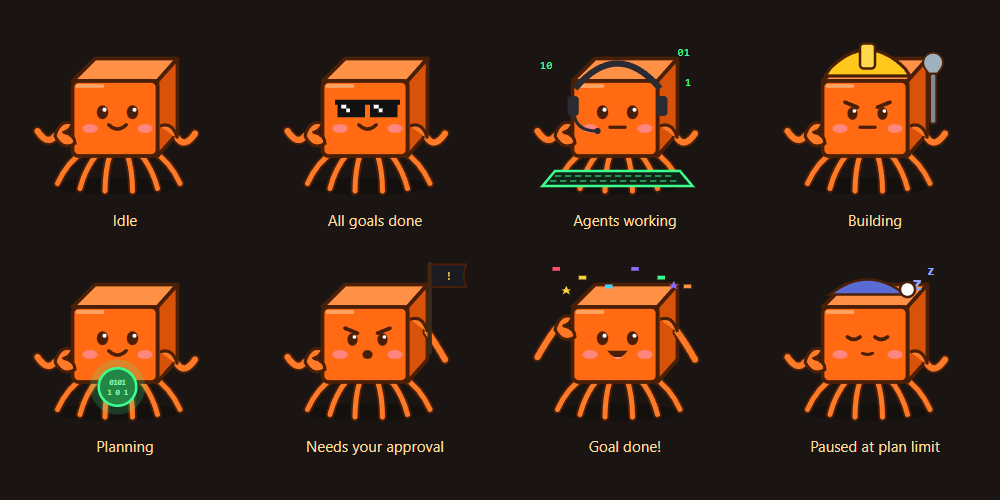

# Agent Office

[](https://github.com/Ic3krem/agent-office/releases/latest) [](https://github.com/Ic3krem/agent-office/releases) [](LICENSE) 

A pixel office for your Claude Code agents. **Kiro**, a little orange cube-crab, manages the office. Give Kiro a task and it plans the work, hires specialist agents, routes risky actions to you for approval, files reports and remembers what it learned in an Obsidian vault. The office itself spends **no tokens**. Every piece of furniture reads files, switches and system data directly, and models only run when an agent works.



## Install

You need [Claude Code](https://claude.com/claude-code) installed and logged in (run `claude` once). Agent Office uses your own Claude Code install and plan.

**Windows** (PowerShell):

```powershell
irm https://raw.githubusercontent.com/Ic3krem/agent-office/main/install.ps1 | iex
```

**macOS / Linux**:

```bash
curl -fsSL https://raw.githubusercontent.com/Ic3krem/agent-office/main/install.sh | bash
```

Both download the latest release, install it and put a shortcut on your desktop. You can also download an installer directly from [Releases](https://github.com/Ic3krem/agent-office/releases): `.exe` (Windows), `.dmg` (macOS Apple Silicon / Intel) or `.AppImage` / `.deb` (Linux). The builds aren't code-signed, so Windows SmartScreen may ask you to confirm with "More info → Run anyway". The macOS script clears Gatekeeper's quarantine flag for you.

## What's in the office

| Object | What it does (no tokens) |
|---|---|
| **Kiro** (desktop overlay) | Lives on your desktop. Click to chat, give tasks and approve requests; double-click to open the office. Its mood follows the work: typing, waving a flag when you're needed, confetti when a goal is done, asleep when paused. |
| **Today board** | Today's goals. Kiro works through them, marks them done or blocked, and suggests follow-ups that wait for your OK. |
| **Bookshelf** | Reports, colour-coded by outcome (green done, amber partial, red needs you), plus an automatic daily report. Search them, or export to **PDF** or **Excel**. |
| **Corkboard** | Agent memory: notes in your Obsidian vault (`Agent Office/Memory`), drawn as pins and strings. Read, delete or link notes. |
| **Filing cabinet** | SOPs: Kiro's brief and each specialist's instructions, editable as vault notes. |
| **Inbox tray** (Kiro's desk) | Requests waiting for your approval. |
| **Breaker box** | Hard switches: Kiro on/off, autopilot, hiring, auto-approve, terminal approvals, and the **subscription guard**, which stops at your plan's 5-hour or weekly limit instead of spending extra-usage credits. |
| **Server rack** | CPU, memory, Docker containers and the office server log. Its LEDs go amber or red when something is wrong. |
| **Whiteboard** | Tokens per day, plan limits and extra-usage credits. |
| **Coffee machine** | Brew an espresso and Kiro's next hire runs on the fast, cheap model. |
| **Arcade · Jukebox · Server plant** | Bug Squasher, generated lo-fi and rain sounds, and a plant that grows with every successful report. |

Agents behave like people. They type at their desk with a live token counter, go to the couch, arcade or jukebox when idle, wait at the water cooler with a countdown when rate-limited, and pace beside a smoking monitor when something fails.

## How it saves tokens

- Agent sessions skip your global plugins, hooks and MCP servers, and load only the tools they use. Measured per-turn context: Kiro 48K → 16K tokens, specialists 42K → 8K.
- Kiro runs on Sonnet at medium effort and picks Haiku, Sonnet or Opus for each hire. It is only nudged to continue when no specialist is out working, since their reports wake it anyway.
- Reports, memory search, the daily summary, exports and every office object are plain code.

## Your data

Everything stays on your machine: transcripts in `~/.claude`, office state in `~/.claude/agent-office`, and reports, daily notes, memory and SOPs in your Obsidian vault (or `~/Documents/Agent Office Vault` if you don't have one). The server listens on `127.0.0.1` only and needs a random key that is stored locally.

## Optional: reply and approve from terminals

Install the bridge plugin so your own Claude Code terminals can receive messages and send approvals to the office:

```
claude plugin marketplace add Ic3krem/agent-office
claude plugin install agent-office-bridge@agent-office
```

## Build from source

```
npm install
npm start          # run the desktop app
npm test
npm run dist       # build an installer for this OS
```

Pushing a tag like `v1.1.0` runs `.github/workflows/release.yml`, which builds Windows, macOS (arm64 and x64) and Linux installers and publishes them as a GitHub release.

## License

[MIT](LICENSE). Not affiliated with Anthropic. Claude and Claude Code are Anthropic products; Agent Office runs on your own Claude Code install.
