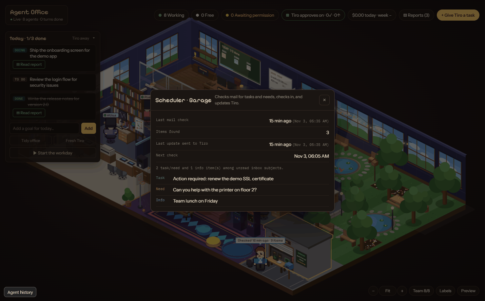

# Agent Office

 

**A pixel office for your own Claude Code agents.** Tiro, a little orange cube-crab, is the office manager. Give Tiro a task and it plans the work, asks you before it hires any of eight specialist agents, shows you the permission prompts Claude Code would show you, files reports and remembers what it learned in a vault of plain Markdown notes. The office itself spends **no tokens**: every piece of furniture reads files, switches and system data directly, and models only run while an agent works, through your own Claude Code install and plan.


## Contents

[Features](#features) - [Gallery](#gallery) - [Install](#install) - [Update](#update) - [Uninstall](#uninstall) - [Configuration](#configuration) - [Build from source](#build-from-source) - [Cutting a release](#cutting-a-release) - [Security model](#security-model) - [Documentation](#documentation) - [Licence](#licence)

## Features

New and current in **1.2.8**:

- **Renamable agents.** Give Tiro and each specialist a display name (up to 20 characters). Ids, folders and types never change, and no agent can take another's current or default name.
- **Hiring approvals.** Every hire made with the Agent tool needs your one-shot approval, which expires after 10 minutes and is cleared whenever Tiro's session ends or resets. A best-effort check also blocks launching `claude` from a shell command; it is not a sandbox.
- **One person per specialist.** An extra agent of an already-hired type is shown as a labelled "helper", never as another full copy.
- **Per-agent memory and history.** Each agent type has its own `memory/` and `history/` folder under Tiro. Every task starts in a fresh context, and an **Agent history** overlay lets you browse past tasks, summaries and transcript paths.
- **Silhouette click areas.** Furniture and characters are picked by their drawn shape (hover shows an outline), and depth sorting keeps a character from being hidden behind its own desk.
- **Garden, park, garage and Scheduler station.** The office has a fenced park and a garage. The Scheduler station shows the last result of the scheduler job, which classifies a local inbox feed into task, need and info items. Agent Office has no mail access of its own.
- **Dynamic island, with an on/off switch.** A notch-style overlay with live agent status, approvals, quick actions, now playing, optional synced lyrics (off until you turn them on), themes and a settings tab. Switch the notch on or off at any time, without restarting: tray menu (Show notch), the dashboard's Breaker box, or the island's own Settings. It is on by default.
- **Security Guard.** An extra, ask-only layer in every Agent Office session and (through the plugin) in your terminals: it asks before secrets leave the computer (whatever `.gitignore`, `.npmignore` or `.dockerignore` claim), before downloaded scripts run or persistence is added, before credential stores or the environment are read, and after untrusted web or mail text tries to steer the agent. It never allows or blocks anything, cannot be weakened by an agent, and keeps a private audit log. A safety net, not a boundary: see [docs/security-guard.md](docs/security-guard.md).
- **Your Claude Code, unchanged.** Tiro and every agent it hires load the same settings, permissions, hooks, MCP servers, CLAUDE.md, skills, plugins and environment as a plain `claude` run. Agent Office adds no approval rules of its own. See [docs/permissions.md](docs/permissions.md).
- **Updater.** Checks an https feed or a local folder and refuses any installer it cannot verify with a SHA-256.
- **Security.** Local-only server with a key, strict Content-Security-Policy with vendored React, ReactDOM and Babel, hardened Electron windows, and verified installs. See the [security model](#security-model).

Also in the office: a Today board, report bookshelf with PDF and Excel export, memory corkboard, editable SOPs, a breaker box of hard switches (including a subscription guard that stops at your plan limit instead of spending extra-usage credits), a server rack, coffee machine, arcade, jukebox and more. Tiro lives on your desktop too, and its mood follows the work:


### The team

Tiro leads a fixed team of eight specialists, at most 8 working at once:

| Name | Role | Model | Tools |
|---|---|---|---|
| Pixel | Frontend engineer | sonnet | read, web, Bash, Edit, Write |
| Forge | Backend engineer | sonnet | read, web, Bash, Edit, Write |
| Warden | Security reviewer | opus | read-only (+ web, Bash) |
| Probe | QA and test engineer | sonnet | read-only (+ web, Bash) |
| Atlas | Deep researcher | opus | read-only (+ web, Bash) |
| Cabalan | Researcher | haiku | read-only (+ web, Bash) |
| Tally | Task checker and organizer | haiku | Read, Grep, Glob, Edit, Write |
| Scribe | SOP and document writer | sonnet | read, web, Edit, Write |

Old type names (researcher, builder, ops, writer, reviewer) still work and map to Cabalan, Forge, Forge, Scribe and Probe. Agent sessions skip your global plugins, hooks and MCP servers and load only the tools they use, which cut measured per-turn context from 48K to 16K tokens for Tiro and from 42K to 8K for specialists. Tiro runs on Sonnet at medium effort and picks Haiku, Sonnet or Opus for each hire.

## Gallery

All screenshots use demo data. The [user guide](docs/GUIDE.md) has the rest.

| The office | Approve each hire |
|---|---|
|  |  |

| Rename your team | Per-agent history |
|---|---|
|  |  |

| Scheduler station | Click outlines |
|---|---|
|  |  |

## Install

**Requirements:** [Claude Code](https://claude.com/claude-code) installed and logged in (run `claude` once). Agent Office uses your own Claude Code install and plan. Windows 10 or later, macOS, or Linux.

> **Distribution status:** this repository is private and there is no public download host yet, so Agent Office is **installed and updated by invitation**: build it from source (below) or use the installer the owner sends you. The install scripts and the in-app updater expect release files at a public URL, so they cannot reach a private repository and will say so. The notes below describe how a published release is installed once a public host exists.

**With an installer you were given.** Run `Agent-Office-Setup-<version>.exe` (a normal setup wizard where you can pick the folder; it adds a Start menu entry and a desktop shortcut). If you also received the release folder (`latest.json`, `latest.json.sig` and the installer), you can check it before installing: set `AGENT_OFFICE_VERIFY_ONLY` to the folder's path and run `install.ps1` or `install.sh` from this repository. The check verifies the **Ed25519 signature** of the manifest against the release key built into the script (fingerprint in [SECURITY.md](SECURITY.md)) and the installer's **SHA-256**, and installs nothing.

**Install scripts (for a published release).** `install.ps1` and `install.sh` take the release tag from the script itself, download `latest.json` and `latest.json.sig` from that tag's release page, verify the signature and the SHA-256, and only then install. They stop with a plain message if the release page is not reachable (for example HTTP 401, 403 or 404 because the repository is private) or if any check fails.

The builds are **not code-signed**. Windows SmartScreen may ask you to confirm with "More info", then "Run anyway". The macOS script clears Gatekeeper's quarantine flag for you.

## Update

While the repository is private the updater cannot reach any release, so it reports that it could not check; updates are installed by hand from an installer the owner sends. The rest of this section describes how updates work once releases are published on a public host.

Open the island's Settings tab and use **Updates**. The app checks the signed release manifest published with the newest GitHub release of Ic3krem/agent-office. The feed address is fixed in the app; nothing in the page or in `kiro.json` can change it. A release is offered only when its `latest.json` carries a valid **Ed25519 signature** from the release key pinned in the app and a SHA-256 for the installer, and only when it is **newer** than the running version (a downgrade is never offered).

Checking on start is on by default but only checks. Installing always needs your confirmation: the app itself (not the page) shows a dialog, then downloads the installer into a fresh folder only you can access, checks the SHA-256, checks it again immediately before starting it, and quits so the installer can replace the app. You can also re-run the install script from the tag you want. Organisations that mirror releases can point the app at their own signed manifest with the `AGENT_OFFICE_UPDATE_FEED` environment variable of the app process; the signature rules still apply. Details: [docs/island-spec.md](docs/island-spec.md); how releases are signed: [docs/RELEASING.md](docs/RELEASING.md).

## Uninstall

- **Windows:** Settings, Apps, Installed apps, Agent Office, Uninstall.
- **macOS:** delete `/Applications/Agent Office.app`.
- **Linux:** delete `~/.local/bin/agent-office.AppImage` and the `agent-office.desktop` entries; if you installed the `.deb`, remove it with your package manager.
- Your data stays in place: `~/.claude/agent-office` (state and per-agent folders) and your vault notes. Delete them for a clean slate.

## Configuration

State lives in `~/.claude/agent-office/`. Preferences are in `kiro.json`; the tray menu and the island Settings tab write most of them, and you rarely need to edit it by hand.

| Setting in `kiro.json` | Meaning |
|---|---|
| `agentNames` | Display-name overrides (`tiro` and the eight specialist keys). |
| `islandMode` | `always` (default) or `smart`. (`off` is an older spelling of "no notch" and is converted to `notchEnabled: false` on first start.) |
| `islandSettings.notchEnabled` | The notch exists: `true` (default) or `false` (the window is closed and nothing runs for it). |
| `islandSettings.notchShortcut` | Optional global shortcut that toggles the notch, for example `Ctrl+Alt+N` (empty = none, the default; 2 or 3 modifiers plus a letter, digit or F-key; `Ctrl+Alt+K` is reserved). |
| `islandMute` | Silence the approval and done chimes. |
| `islandDisplay` | `cursor` (default), `primary` or a display id. |
| `islandSettings` | Island theme, motion, pinned actions, clocks, `nowPlaying`, `lyrics` (off by default: turning it on looks songs up at lrclib.net, see the guide), `kiroFace`, `animate`. |
| `updateAuto` | Check for updates on start (default on). The update feed itself is fixed in the app and cannot be set here. |
| `autostart` | Start with Windows (packaged app, default on). |
| `hidden`, `x`, `y` | Whether the desktop Tiro is hidden, and where it sits. |
| `workDir` | Folder Tiro runs in, so Claude Code resolves project settings and CLAUDE.md as it would from there (default: your home folder). |
| `retentionDays` | Delete old history summaries, reports and finished goals after this many days (7 or more; off by default). |
| `schedulerMailbox` | The one mailbox the scheduler job may report on (see below). |

**Environment variables**

| Variable | Effect |
|---|---|
| `AGENT_OFFICE_PORT` | Port for `node server.mjs`. The desktop app always uses 4777, so use this for dev servers on a spare port. |
| `AGENT_OFFICE_TEAM_ONLY=1` | Presentation mode: show only Tiro and its specialists. |
| `AGENT_OFFICE_SHOW_ALL=1` | Show the logs and prompts of your other Claude sessions on their desks (hidden by default). |
| `AGENT_OFFICE_MAILBOX` | The one mailbox the scheduler job reports on (overrides `schedulerMailbox`). |
| `CLAUDE_CODE_PATH` | Where the Claude Code executable is, if it is not found automatically. |

Other files in `~/.claude/agent-office/`: `bridge.json` (port and terminal bridge key, do not share), `switches.json`, `goals.json`, `credits.json`, `scheduler.json`, and `agents/`. Reports, daily notes, memory and SOPs live in your Obsidian vault (or `~/Documents/Agent Office Vault`). Claude Code transcripts stay in `~/.claude/projects`. The full list is in the [guide](docs/GUIDE.md#settings-files).

**Scheduler job.** `node scheduler-job.mjs --dry-run` tries it without writing anything. Agent Office has no mail access built in: you provide a read-only reader that writes `~/.claude/agent-office/inbox-feed.json`. See [docs/scheduler.md](docs/scheduler.md).

**Terminal bridge (optional).** Install the bridge plugin so your own Claude Code terminals can receive messages and send approvals to the office:

```
claude plugin marketplace add Ic3krem/agent-office
claude plugin install agent-office-bridge@agent-office
```

## Build from source

Node 24 is what CI uses.

```
npm ci             # install exactly what package-lock.json lists
npm start          # run the desktop app (electron .)
npm test           # all node:test suites; no network or models needed
npm run dist       # electron-builder: installer for this OS, written to dist/
```

`node --check <file>` syntax-checks any `.mjs` file. To run a server next to an installed copy, set `AGENT_OFFICE_PORT` and a temporary `USERPROFILE` so it does not touch the installed app's key and state.

`npm run dist` on Windows produces `dist/Agent-Office-Setup-<version>.exe` (NSIS), plus `latest.yml`, a `.blockmap` and the unpacked app. macOS builds are `Agent-Office-<version>-<arch>.dmg` and `.zip`; Linux builds are `Agent-Office-<version>-<arch>.AppImage` and `.deb`. Any new root-level `.mjs` file must be added to `build.files` in `package.json`, or the packaged app will not start.

## Cutting a release

The full, current procedure is in [docs/RELEASING.md](docs/RELEASING.md): clean branch and `npm test`, version bump and changelog, build and test the exact installer, sign the release manifest offline with `scripts/sign-release.mjs`, publish the installer together with `latest.json` and `latest.json.sig`, then bump the tag in `install.ps1` and `install.sh`. `.github/workflows/release.yml` is **manual-only** (`workflow_dispatch`), so a tag push does not start CI and cannot replace the tested installer.

More in [docs/RESOURCES.md](docs/RESOURCES.md).

## Security model

- **Local only, two separate credentials.** The server binds `127.0.0.1` and rejects any other `Host` header (DNS rebinding). The terminal bridge key in `bridge.json` opens `/bridge/*` only. The UI key exists only in the Electron process and the server's memory and reaches the windows as an HttpOnly, SameSite=Strict cookie, so an agent that can read `bridge.json` still cannot approve its own requests. Decisions also need a per-session nonce. Keys are compared by hash in constant time and never logged.
- **Strict Content-Security-Policy.** Pages load scripts, styles and fonts only from the app itself (`script-src 'self'`, plus inline and eval, which the page runtime needs). React, ReactDOM, Babel standalone and the fonts are vendored in `public/` (pinned SHA-384 hashes for the scripts, OFL licence texts for the fonts), so nothing loads from a CDN or Google Fonts. Framing, plugins and `<base>` tricks are blocked.
- **Electron hardening.** Windows run with context isolation and sandbox on, `nodeIntegration` off and `webSecurity` on. They cannot navigate away from the local server or open webviews, and external links open in your browser.
- **Verified installs.** The install scripts and the updater check SHA-256 before running anything, and use https only.
- **Hiring and approvals.** Agent-tool hires require your one-shot approval, tied to the goal and the exact first prompt (a best-effort check also blocks launching `claude` from Bash; it is not a sandbox). Tool permissions are Claude Code's own: what your settings allow runs, what they deny is denied, and what Claude Code would ask about is shown to you with Claude Code's choices. Agent Office does not auto-approve anything.
- **No built-in mail access.** The scheduler only reads a local feed file.
- **Your data.** Office state and notes stay on your machine; model calls go through your Claude Code install to Anthropic, as in the terminal. The server needs the local key for every API call.
- **Unsigned builds.** If in doubt, compare the SHA-256 the install script prints with the one GitHub shows on the release asset.

Report a vulnerability by opening a private security advisory on the GitHub repository.

## Documentation

| Document | What it covers |
|---|---|
| [docs/GUIDE.md](docs/GUIDE.md) | The full user guide: every panel, the island, tray, settings files, API table, troubleshooting, FAQ |
| [docs/RESOURCES.md](docs/RESOURCES.md) | Index of links, architecture notes, dev setup, release checklist |
| [CHANGELOG.md](CHANGELOG.md) | What changed, 1.1.0 to 1.2.8 |
| [docs/security-guard.md](docs/security-guard.md) | The Security Guard: what it asks about, the prompts you will see, settings, limits |
| [docs/permissions.md](docs/permissions.md) | Claude Code parity: what is the same, what differs, what reaches you |
| [docs/agents-and-memory.md](docs/agents-and-memory.md) | Team, hiring gate, per-agent memory and history |
| [docs/scheduler.md](docs/scheduler.md) | Scheduler station, job and feed file |
| [docs/office-spec.md](docs/office-spec.md), [docs/island-spec.md](docs/island-spec.md) | Office world and island design notes |
| [THIRD_PARTY_NOTICES.md](THIRD_PARTY_NOTICES.md) | Dependency licenses |

## Licence

Agent Office is proprietary software. **Copyright (c) 2026 Ic3krem. All rights reserved.** Nobody else may use, copy, modify, publish or distribute it unless the owner gives permission in writing; contributions are not accepted without a signed written agreement. Versions published earlier under the MIT licence (v1.1.0 to v1.1.4 and v1.2.5) remain available under the MIT terms they were released with. The full text is in [LICENSE](LICENSE), which is a **draft that still needs a lawyer's review**. Third-party components stay under their own licences, listed in [THIRD_PARTY_NOTICES.md](THIRD_PARTY_NOTICES.md); `@anthropic-ai/claude-agent-sdk` is Anthropic's proprietary software under its own terms. Not affiliated with Anthropic: Claude and Claude Code are Anthropic products, and Agent Office runs on your own Claude Code install.
