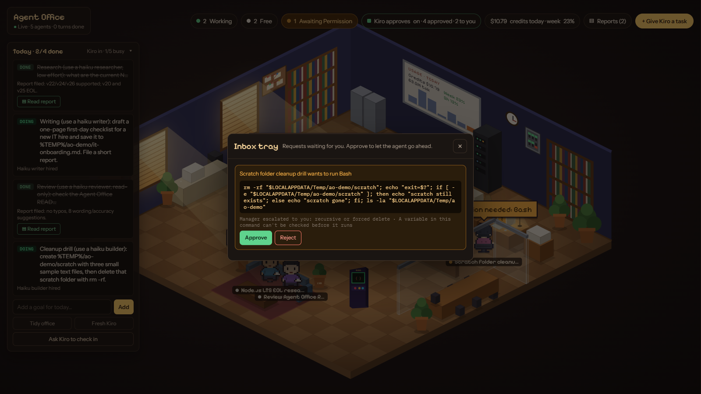
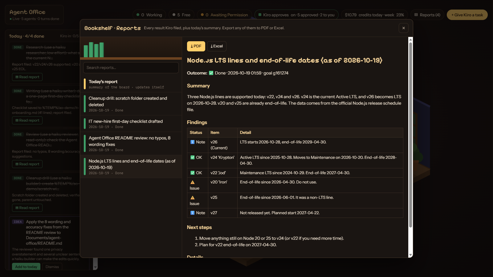
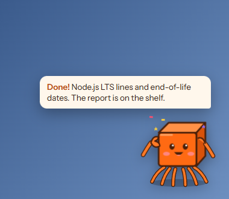
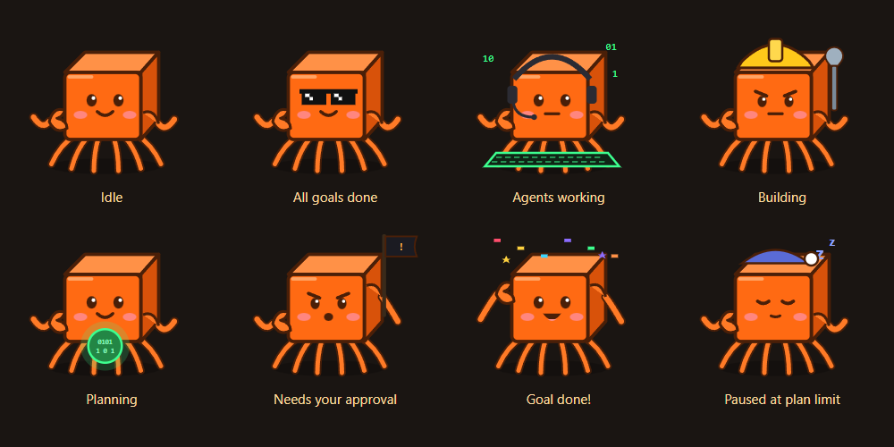

# Agent Office

[](https://github.com/Ic3krem/agent-office/releases/latest) [](https://github.com/Ic3krem/agent-office/releases) [](LICENSE) 

A pixel office for your Claude Code agents. **Tiro**, a little orange cube-crab, manages the office. Give Tiro a task and it plans the work, hires specialist agents, routes risky actions to you for approval, files reports and remembers what it learned in an Obsidian vault. The office itself spends **no tokens**. Every piece of furniture reads files, switches and system data directly, and models only run when an agent works.


## See it

| Approvals come to you | Reports you can actually read |
|---|---|
|  |  |

| Tiro on your desktop | Tiro's moods |
|---|---|
|  |  |

These screenshots come from a real test run: four low-effort tasks (a research lookup, a checklist draft, a README review and a cleanup drill), all run on Haiku specialists.

## Install

You need [Claude Code](https://claude.com/claude-code) installed and logged in (run `claude` once). Agent Office uses your own Claude Code install and plan.

**Windows** (PowerShell):

```powershell
irm https://raw.githubusercontent.com/Ic3krem/agent-office/main/install.ps1 | iex
```

**macOS / Linux**:

```bash
curl -fsSL https://raw.githubusercontent.com/Ic3krem/agent-office/main/install.sh | bash
```

Both download the latest release over https, **verify its SHA-256** against the digest GitHub publishes for that asset (they stop if it is missing or does not match), install it and put a shortcut on your desktop. You can also download an installer directly from [Releases](https://github.com/Ic3krem/agent-office/releases): `.exe` (Windows), `.dmg` (macOS Apple Silicon / Intel) or `.AppImage` / `.deb` (Linux). The builds aren't code-signed, so Windows SmartScreen may ask you to confirm with "More info → Run anyway". The macOS script clears Gatekeeper's quarantine flag for you.

Piping a script into your shell trusts whatever is on `main`. To review first, or to pin a release, download the script (for example `.../Ic3krem/agent-office/v1.2.4/install.ps1`), read it, then run it from disk.

### Update

Agent Office checks for new versions from the island's Updates panel. Set the update feed to an `https://` JSON URL (a GitHub release API URL works) or a local file or folder. An installer fetched over the network is only run when the feed supplies its SHA-256 and the download matches; otherwise it is refused. You can also re-run the install script, which replaces the app in place.

### Uninstall

- **Windows:** Settings, Apps, Installed apps, Agent Office, Uninstall (or run the uninstaller in `%LOCALAPPDATA%/Programs`). **macOS:** delete `/Applications/Agent Office.app`. **Linux:** delete `~/.local/bin/agent-office.AppImage` and the `agent-office.desktop` entries.
- Your data is left in place: `~/.claude/agent-office` (state, per-agent folders) and the vault notes. Delete them if you want a clean slate.

## What's in the office

| Object | What it does (no tokens) |
|---|---|
| **Tiro** (desktop overlay) | Lives on your desktop. Click to chat, give tasks and approve requests; double-click to open the office. Its mood follows the work: typing, waving a flag when you're needed, confetti when a goal is done, asleep when paused. |
| **Today board** | Today's goals. Tiro works through them, marks them done or blocked, and suggests follow-ups that wait for your OK. |
| **Bookshelf** | Reports, color-coded by outcome (green done, amber partial, red needs you), plus an automatic daily report. Search them, or export to **PDF** or **Excel**. |
| **Corkboard** | Agent memory: notes in your Obsidian vault (`Agent Office/Memory`), drawn as pins and strings. Read, delete or link notes. |
| **Filing cabinet** | SOPs: Tiro's brief and each specialist's instructions, editable as vault notes (in the app or in Obsidian). Edits apply from Tiro's next turn. Edit `specialist-<key>.md` to retune one of the eight specialists; optional frontmatter sets `description`, `tools` and `model`. |
| **Inbox tray** (Tiro's desk) | Requests waiting for your approval. |
| **Breaker box** | Hard switches: Tiro on/off, autopilot, hiring, auto-approve, terminal approvals, and the **subscription guard**, which stops at your plan's 5-hour or weekly limit instead of spending extra-usage credits. |
| **Server rack** | CPU, memory, Docker containers and the office server log. Its LEDs go amber or red when something is wrong. |
| **Whiteboard** | Tokens per day, plan limits and extra-usage credits. |
| **Coffee machine** | Brew an espresso so Tiro's next hire uses the fast, cheap model. |
| **Arcade · Jukebox · Server plant** | A Bug Squasher game, generated lo-fi and rain sounds, and a plant that grows with every successful report. |

Agents behave like people. They type at their desk with a live token counter, go to the couch, arcade or jukebox when idle, wait at the water cooler with a countdown when rate-limited, and pace beside a smoking monitor when something fails.

## New in 1.2.x

- **Renamable team:** give Tiro and each specialist a display name; folders, ids and the `subagent_type` never change, and two agents can never share a name.
- **Strict hiring gate:** Tiro must ask (`request_hire`) and you approve each hire once; an approval is single-use, expires after 10 minutes and is cleared whenever the manager session ends or resets, or hiring is switched off.
- **Per-agent memory and history:** every agent has its own folder under `~/.claude/agent-office/agents/tiro/<type>/` with `memory/` (the only thing carried between tasks, since every hire starts in a fresh context) and `history/` (a task index plus each final report and its transcript path). Browse it with the **Agent history** button. Secrets are scrubbed from summaries.
- **Outline click areas:** office objects are clicked by their drawn outline, small pieces win over big ones behind them, and characters are never hidden behind their own desk.
- **Garage and Scheduler:** a Scheduler station shows what `scheduler-job.mjs` last wrote to `~/.claude/agent-office/scheduler.json`. The job classifies unread-mail subjects from a local feed file into task, need or info, leaves Tiro a subject-only note, is read-only and sends nothing. Run `node scheduler-job.mjs --dry-run` to try it; set `AGENT_OFFICE_MAILBOX` to the one mailbox it may report on. A separate approved reader must produce `inbox-feed.json`.
- Dynamic-island overlay with now-playing and lyrics, and an update checker with SHA-256 verification.

## How it saves tokens

- Agent sessions skip your global plugins, hooks and MCP servers, and load only the tools they use. Measured per-turn context drops from 48K to 16K tokens for Tiro and from 42K to 8K for specialists.
- Tiro leads a fixed team of eight specialists (at most 8 work at once):

| Name | Role | Model | Tools |
|---|---|---|---|
| Pixel | Frontend engineer | sonnet | read, web, Bash, Edit, Write |
| Forge | Backend engineer | sonnet | read, web, Bash, Edit, Write |
| Warden | Security reviewer | opus | read-only (+ web, Bash) |
| Probe | QA and test engineer | sonnet | read-only (+ web, Bash) |
| Atlas | Deep researcher | opus | read-only (+ web, Bash) |
| Cabalan | Researcher | haiku | read-only (+ web, Bash) |
| Tally | Task checker and organizer | haiku | Read, Grep, Glob, Edit, Write |
| Scribe | SOP and document writer | sonnet | read, web, Edit, Write |

Old names (researcher, builder, ops, writer, reviewer) still work and map to Cabalan, Forge, Forge, Scribe and Probe. See `docs/office-spec.md` for the planned office world.

Tiro runs on Sonnet at medium effort and picks Haiku, Sonnet or Opus for each hire. Tiro is only nudged to continue when no specialist is out working, since their reports wake it anyway.
- Reports, memory search, the daily summary, exports and every office object are plain code.

## Your data

Office state and notes stay on your machine; model calls go through your Claude Code install to Anthropic, as they do in the terminal. Transcripts are in `~/.claude`, office state in `~/.claude/agent-office`, and reports, daily notes, memory and SOPs in your Obsidian vault (or `~/Documents/Agent Office Vault` if you don't have one). The server listens on `127.0.0.1` only, rejects foreign `Host` headers, needs a random key that is stored locally, and sends a Content-Security-Policy (the only remote host allowed is Google Fonts). Electron windows run with context isolation, sandbox and no Node integration, and cannot navigate away from the local server.

## Optional: reply and approve from terminals

Install the bridge plugin so your own Claude Code terminals can receive messages and send approvals to the office:

```
claude plugin marketplace add Ic3krem/agent-office
claude plugin install agent-office-bridge@agent-office
```

## Presentation mode

Set `AGENT_OFFICE_TEAM_ONLY=1` before starting the app to show only Tiro and its specialists (handy for screenshots and demos).

## Build from source

```
npm install
npm start          # run the desktop app
npm test           # node:test suites, no network or models needed
npm run dist       # build an installer for this OS
```

Every `*.mjs` file can be syntax-checked with `node --check <file>`. Local backups (`*.bak-*`), `dist/`, `release-feed/` and local state files are git-ignored.

Pushing a tag like `v1.1.0` runs `.github/workflows/release.yml`, which builds Windows, macOS (arm64 and x64) and Linux installers and publishes them as a GitHub release.

## License

[MIT](LICENSE), (c) 2026 Ic3krem. Dependency licenses are listed in [THIRD_PARTY_NOTICES.md](THIRD_PARTY_NOTICES.md); note that `@anthropic-ai/claude-agent-sdk` is Anthropic's proprietary software under its own terms, not MIT. Not affiliated with Anthropic. Claude and Claude Code are Anthropic products; Agent Office runs on your own Claude Code install.
