# Agent Office user guide (1.2.6)

The current release is v1.2.6. It ships the Windows installer only for now; the macOS and Linux install script finds no asset until those builds are published.

This guide covers every part of the app. For install, update and uninstall see the [README](../README.md). For a link index see [RESOURCES.md](RESOURCES.md).

Contents: [What it is](#what-it-is) - [Starting](#starting) - [The dashboard](#the-dashboard) - [Giving work](#giving-work) - [Approvals](#approvals) - [The team](#the-team) - [Goals, Today and Reports](#goals-today-and-reports) - [The office](#the-office) - [Scheduler](#scheduler-station) - [Agent history](#agent-history) - [Tiro on your desktop](#tiro-on-your-desktop) - [The island](#the-island) - [Tray](#tray) - [Settings files](#settings-files) - [API reference](#api-reference) - [Keyboard and accessibility](#keyboard-and-accessibility) - [Troubleshooting](#troubleshooting) - [FAQ](#faq) - [Security notes](#security-notes)

## What it is

Agent Office is a pixel office for your own Claude Code agents. **Tiro** is the manager. You give Tiro a task, it plans, asks you to approve each specialist it wants to hire, files reports, and remembers things in an Obsidian-style vault of plain Markdown notes. The office itself uses no tokens; models only run while an agent works, through your own Claude Code install and plan.

## Starting

- **Installed app:** open Agent Office from the desktop shortcut or Start menu. It starts its local server and shows Tiro on your desktop. Double-click Tiro (or use the tray menu, Open office) to open the dashboard.
- **From source:** `npm ci`, then `npm start` (see [RESOURCES.md](RESOURCES.md)).
- The server listens on `127.0.0.1` only. The desktop app signs its windows in with a private cookie; a standalone `node server.mjs` prints a one-time sign-in link (valid once, for 5 minutes) instead. There is no key in the URL. Pages opened without signing in can load but cannot read or change anything.

## The dashboard

The header is one row of pills: manager auto-approval, usage and plan limits, reports, and the switches menu. Below it is the office, with the Today panel, the Team panel and the detail pane over it.

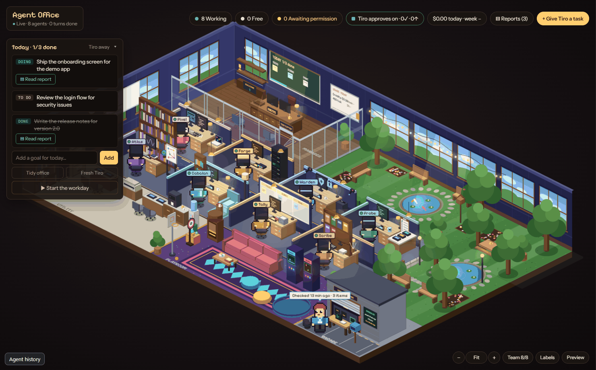

- **Click a character** to open its detail pane: name, role, task, live log of recent events, the approval it is waiting for, and a box to send it a message.
- **Click an empty desk** to see who sits there and what they do.
- **Team n/8** shows how many specialists are hired. The hire cap is 8 working at once.
- A banner appears when the server is unreachable ("Connecting") and clears when it comes back.

## Giving work

1. Type a task in the dispatch box (for example "Review the README and list any wrong claims") and send it. It is added to today's board as a goal and Tiro is told about it.
2. Tiro reads the board, plans, and works. For anything it cannot do itself it asks you to hire a specialist (see Approvals).
3. When a goal produces findings, Tiro files a report and marks the goal done.
4. Tiro keeps going between turns while **Autopilot** is on and goals are open. Switch Autopilot off if you want it to work only when you send something.

You can also message any agent directly from its detail pane, interrupt a running turn, or **Reset** Tiro's conversation (goals and reports stay; Tiro starts a fresh session next time).

## Approvals

There are two kinds, and both show on the dashboard and in the island.

**Hire approvals (strict hiring gate).** Tiro cannot start a specialist by itself. It sends a request with the specialist, the goal and a reason; a card appears with Approve and Deny. One approval buys exactly one hire of that type and expires after 10 minutes. Requests are refused automatically if hiring is switched off, the goal is not open, the reason is too short, 8 specialists are already working, or that specialist is already on the team and idle (Tiro is told to reuse it). Pending cards and unused approvals are cleared when Tiro's session ends or resets or when hiring is switched off. Details: [agents-and-memory.md](agents-and-memory.md).

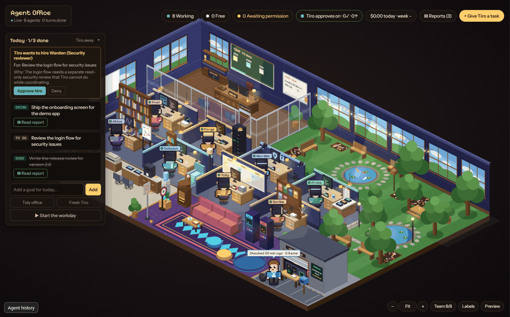

**Tool approvals.** Tiro and the agents run on your own Claude Code configuration: your allow, deny and ask rules, permission mode, hooks and settings decide what happens. Only a request Claude Code itself would ask you about shows up (in the dashboard detail pane and the island), with the full tool input and Claude Code's own choices: **Yes**, **Yes, and don't ask again** (offered only when Claude Code suggests a rule; it writes that same rule to the same settings file Claude Code would), and **No**, optionally with a note telling Claude what to do instead. Nothing is edited, auto-approved or timed out into an answer; a prompt waits until you answer. Questions Claude asks (the multiple-choice question tool) appear as a question card in the island. Terminal sessions still ask in their own dialog when no tab is open. See [permissions.md](permissions.md).

## The team

Tiro leads eight specialists:

| Name | Role | Model |
|---|---|---|
| Pixel | Frontend engineer | sonnet |
| Forge | Backend engineer | sonnet |
| Warden | Security reviewer | opus |
| Probe | QA and test engineer | sonnet |
| Atlas | Deep researcher | opus |
| Cabalan | Researcher | haiku |
| Tally | Task checker and organizer | haiku |
| Scribe | SOP and document writer | sonnet |

Each specialist is one person with one desk. If a second agent of the same type ever starts, it is drawn as a labelled "helper" of the first.

**Renaming.** In the Team panel you can give Tiro and each specialist a display name of up to 20 characters. A name cannot equal another agent's current or default name. Blank resets to the default. Renames only change what is shown: ids, desks and memory folders stay the same, so history stays with the agent.

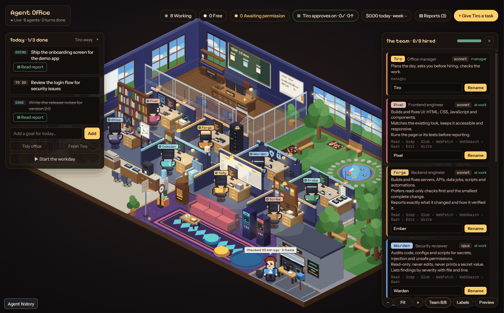

**SOPs.** In the filing cabinet, Tiro's brief and each specialist's instructions are editable notes. Edits apply from Tiro's next turn. Each specialist's note can set `description`, `tools` and `model` in its frontmatter.

## Goals, Today and Reports

- **Today panel** lists today's goals (proposed, todo, doing, blocked, done). Tiro may propose follow-ups; they wait for you to accept or dismiss. Use Tidy to clear finished goals and idle desks from view.
- **Reports** (the bookshelf, or the Reports pill) are color-coded by outcome: green done, amber partial, red needs you. Each has a summary, a findings table and next steps. Search them, open one, and export it to **PDF** (print page) or **Excel**. A daily report is written automatically.
- **Memory** (the corkboard) shows the notes in your vault as pins and strings. Read, delete or link notes. The vault is your open Obsidian vault, or `~/Documents/Agent Office Vault`.

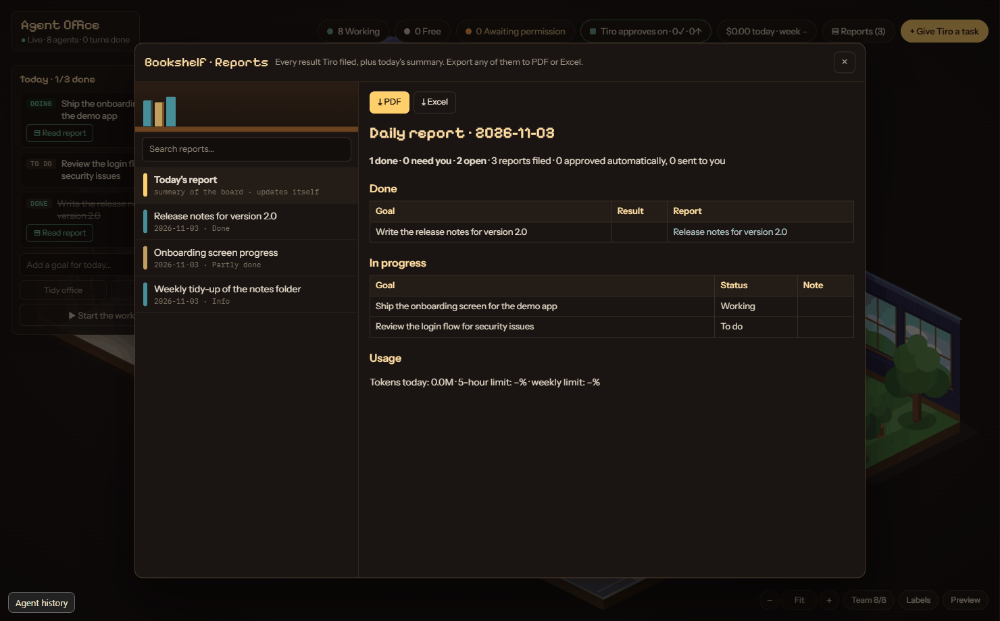

## The office

The world is isometric with five zones: Tiro's glass office (top left), the focus area with eight desks, the garden and park (top right, with a gate), the playroom (bottom right) and a utility strip (bottom left). The garage and Scheduler station sit beside the playroom.

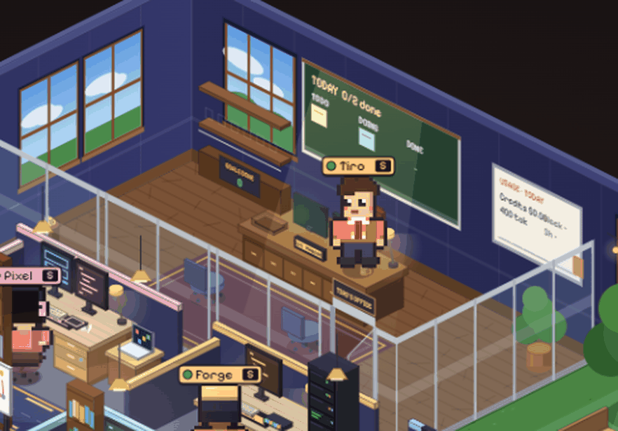

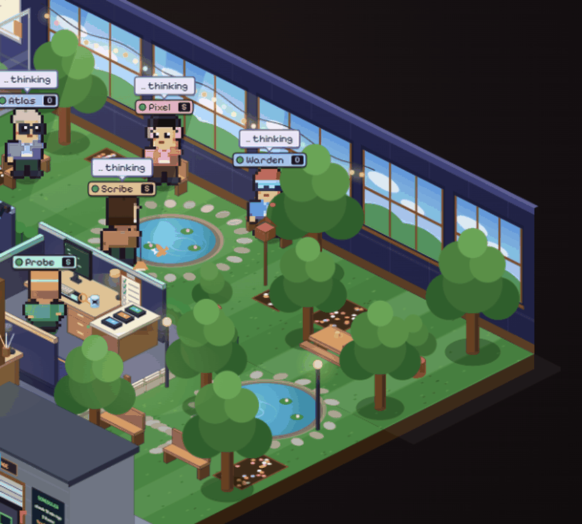

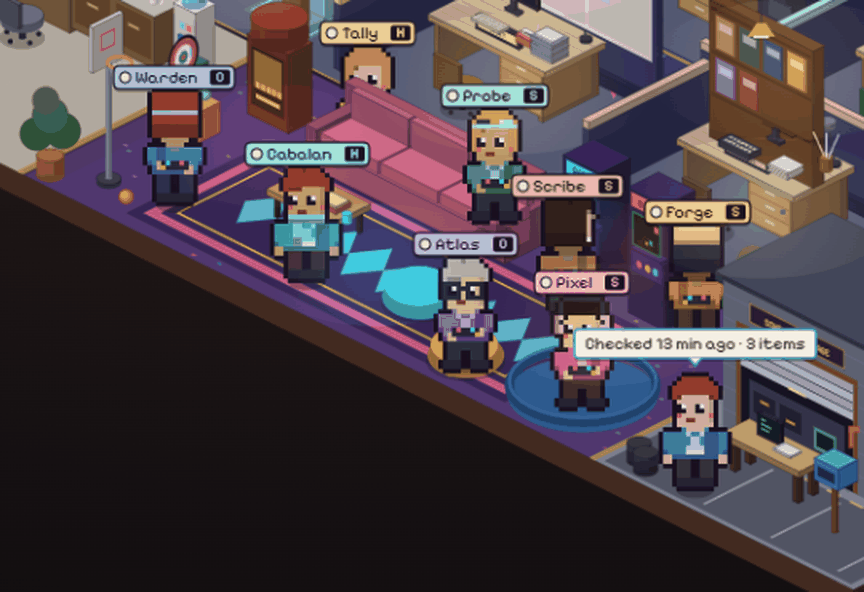

- **Working** agents sit at their own desk. Thinking agents walk to the garden or park. When the board is empty, idle agents go to the playroom. A rate-limited agent waits at the water cooler. A finished goal sends its agent to Tiro's office to report, then back.
- **Objects:** Today board, Bookshelf (reports), Corkboard (memory), Filing cabinet (SOPs), Inbox tray, Breaker box, Server rack, Whiteboard (tokens and limits), Coffee machine (espresso: the next hire uses the fast model), Arcade, Jukebox, Server plant, and the Scheduler garage and mailbox.
- **Breaker box switches:** Tiro (manager) on/off, Autopilot, Hiring, Terminal approvals, and the Subscription guard, which stops at the 5-hour or weekly plan limit instead of spending extra-usage credits.
- **Click outlines.** Objects and people are picked by their drawn shape, not a rough box. Hover shows a gold outline that follows the silhouette; where pieces overlap, the smaller one wins. Characters are depth-sorted so none is hidden behind its own desk.

- **Camera.** Mouse wheel zooms about the cursor (1x to 3x), drag pans when zoomed, keys `+`, `-` and `0` zoom and reset, and corner buttons do the same. Bottom-right controls: Team count, Labels (zone names), and Preview, which plays demo scenes (work, think, blocked, report, empty, tour) without touching real data.

## Scheduler station

The Scheduler station is the garage and the mailbox. Click either to open a read-only panel showing the last check time, the count of tasks and needs found, when Tiro was last updated, the next check, a note, and the item list (title, kind, time). The panel reads `~/.claude/agent-office/scheduler.json` through `POST /api/scheduler`. It says "no data yet" until the scheduler job has written the file.

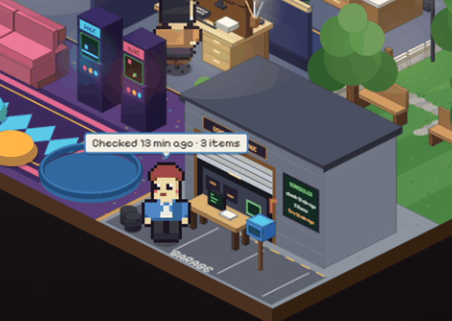

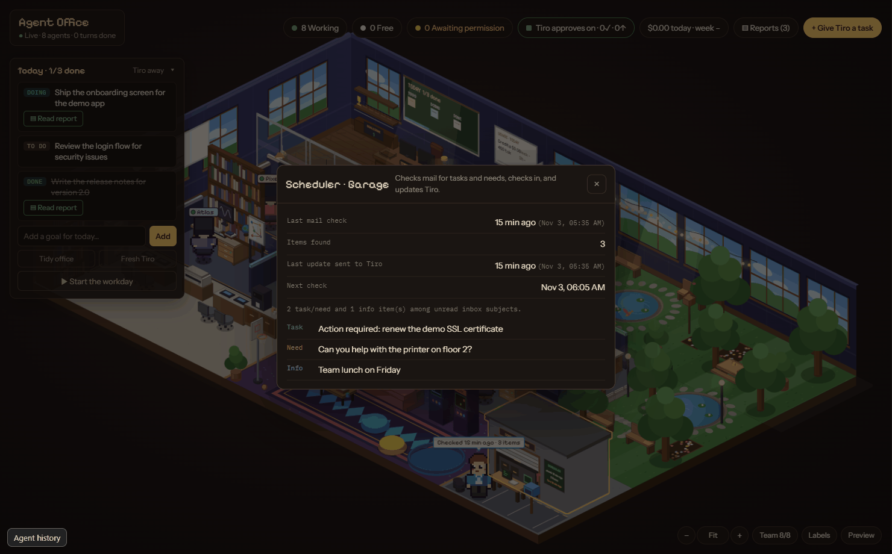

The job, its feed file and its mailbox setting are in [scheduler.md](scheduler.md). Agent Office has no mail access built in.

## Agent history

The **Agent history** button (bottom left) opens a three-pane browser: agents on the left, that agent's tasks (with search) in the middle, and the task summary on the right with the transcript path and the agent's folder paths. Every hire starts in a fresh context; the only thing carried over is that agent's own memory folder. Folders are under `~/.claude/agent-office/agents/tiro/<type>/{memory,history}`. Summaries are redacted for secrets. See [agents-and-memory.md](agents-and-memory.md).

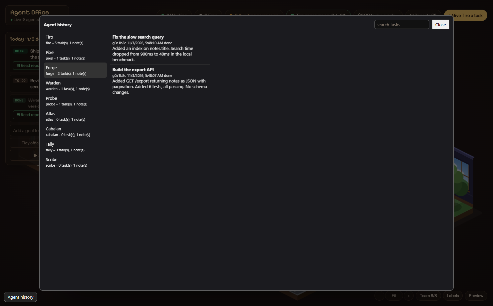

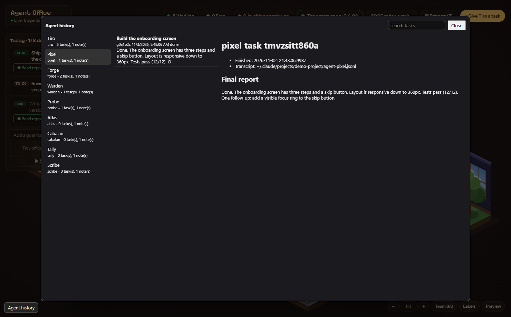

## Tiro on your desktop

Tiro lives as a small always-on-top character on your desktop. Click to chat, give tasks and approve requests; double-click to open the office. Its mood follows the work: idle, typing, waving a flag when you are needed, confetti when a goal is done, asleep when paused. Hide or show it from the tray.

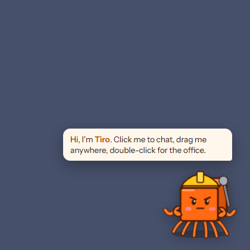

## The island

The island is a notch-style overlay at the top centre of the screen. Its window is transparent and click-through except for the island itself.

- **Collapsed:** shows Tiro's eyes (idle, working, waiting for approval, done, offline). While music plays it widens to show the title, artist and a synced lyric line.
- **Expanded** (hover, click, `Ctrl+Alt+K`, or when an approval arrives): tabs Home, Calendar and Settings, a dock of quick actions (Today, Reports, Usage, Office, Chat, and others you pin), approval buttons (keys `Y` and `N` answer the first request, `Esc` waves it away), and a Now playing card with previous, play-pause and next.
- **Modes:** Always, Smart (hides when idle or when a fullscreen app is running and peeks back when the cursor touches the top edge) and Off. Choose from the tray.
- **Settings tab:** theme (Ember, Midnight, Forest, Light, Custom accent), motion preset, pinned actions (up to 8), 12 or 24 hour clock, optional second clock, week start, edge and leave delays, now playing, Tiro face, animation and lyrics. Lyrics are looked up online (title, artist, album and duration only); turn them off if you prefer.
- **Updates:** see [the README](../README.md#update). Set an https feed or a local folder, check, and install with one click. An installer downloaded over the network must come with a SHA-256 that matches; otherwise it is refused.

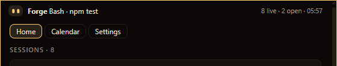

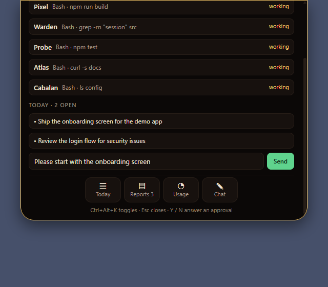

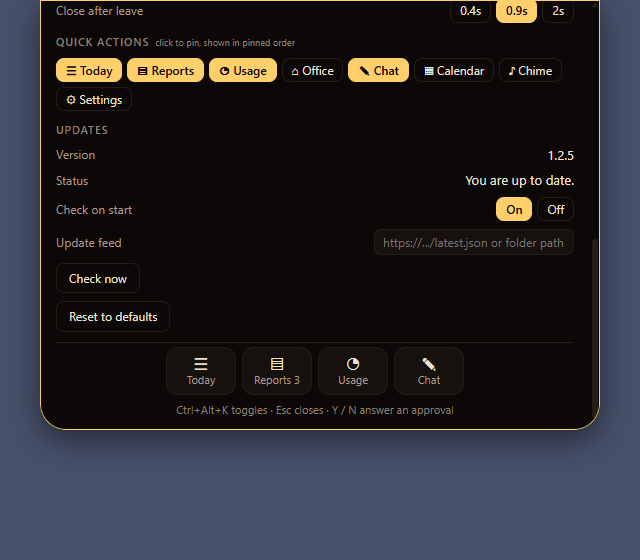

## Tray

The tray menu has: Open office, Island (mode, chime on approval or done, display choice), Show Tiro, Start with Windows (packaged app only) and Quit Agent Office.

## Settings files

All state is under `~/.claude/agent-office/` (your home folder). Nothing here needs editing by hand, but it is plain JSON and safe to inspect.

| File or folder | What it holds |
|---|---|
| `bridge.json` | Server port and the terminal bridge key (opens `/bridge/*` only). The UI key is never stored. |
| `kiro.json` | Desktop and island preferences: `agentNames`, `islandMode`, `islandMute`, `islandDisplay`, `islandSettings`, `updateAuto`, `hidden`, optional `schedulerMailbox`. |
| `switches.json` | Breaker box switches. |
| `manager.json` | Tiro auto-approval on or off. |
| `manager-session.json` | Id of Tiro's current session (one per day). |
| `goals.json` | Today's board. |
| `credits.json` | Extra-usage credit log. |
| `scheduler.json`, `scheduler-seen.json`, `inbox-feed.json` | Scheduler status, its dedupe list, and its input feed. |
| `agents/tiro/...` | Per-agent memory and history. |

Reports, daily notes, memory and SOPs live in your vault (`Agent Office/` folder). Claude Code transcripts stay in `~/.claude/projects`. Environment variables: `AGENT_OFFICE_PORT` (server port), `AGENT_OFFICE_TEAM_ONLY=1` (show only Tiro and its team), `AGENT_OFFICE_MAILBOX` (scheduler mailbox) and `CLAUDE_CODE_PATH` (where Claude Code is).

## API reference

The dashboard, island and tools talk to a local HTTP API. Every call to `/api/...` is a **POST** with a JSON body, authenticated by the UI session cookie (there is no key in URLs or headers; the bridge key only opens `/bridge/*`). Decision endpoints (`/api/decide`, `/api/hire/decide`, `/api/switch`, `/api/send`, `/api/task`, `/api/sops/save`, `/api/boss-reset`) also need the per-session nonce in the `x-nonce` header. Not signed in returns 401, a missing nonce 403, a wrong `Host` header 403. `GET /api/stream` is a Server-Sent Events feed of the live snapshot. The bridge plugin also uses `/bridge/ask` and `/bridge/poll`.

| Endpoint | Body | Purpose |
|---|---|---|
| `/api/stream` (GET) | none | Live snapshot (agents, goals, approvals, usage). |
| `/api/send` | `{id, text}` | Message an agent session. |
| `/api/interrupt` | `{id}` | Interrupt a running turn. |
| `/api/decide` | `{askId, decision, always?, message?, answers?}` | Answer a Claude Code permission prompt (`allow`, `deny`, `terminal`); `always` writes Claude Code's suggested rule, `message` tells Claude what to do instead, `answers` answers a question card. |
| `/api/task` | `{text}` | Add a goal and tell Tiro. |
| `/api/goal` | `{id, action}` | `accept`, `dismiss`, `done` or `reopen` a goal. |
| `/api/boss` | none | Nudge Tiro to read the board. |
| `/api/boss-reset` | none | Forget Tiro's conversation (goals and reports stay). |
| `/api/hire/decide` | `{id, approve, note?}` | Approve or deny a hire request. |
| `/api/roster` | none | The eight specialists with names, roles and models. |
| `/api/names`, `/api/names/set`, `/api/names/reset` | `{key, name}` / `{key?}` | Read, set or reset display names. |
| `/api/agents/overview`, `/api/agents/tasks`, `/api/agents/task` | `{key, q?}` / `{key, id}` | Per-agent history browser. |
| `/api/scheduler` | none | Scheduler status (read-only). |
| `/api/reports`, `/api/report`, `/api/daily` | `{file}` for one | List and read reports and the daily summary. |
| `/api/memory/graph`, `/note`, `/delete`, `/link` | by note name | Browse and edit vault notes. |
| `/api/sops`, `/api/sops/save` | `{name, text}` | Read and edit SOPs. |
| `/api/switch` | `{name, on}` | Flip a breaker box switch. |
| `/api/rack`, `/api/limits` | none | Server stats; plan limits. |
| `/api/tidy` | none | Clear finished goals and idle desks. |

Also: `GET /print/report`, `/print/daily`, `/export/report.xlsx` and `/export/daily.xlsx` (key required) produce printable pages and Excel files.

## Keyboard and accessibility

- Office objects and desks are focusable with the keyboard and have labels (name, role, status).
- Camera: `+`, `-`, `0`, mouse wheel, drag.
- Island: `Ctrl+Alt+K` toggles it; `Y` and `N` answer the first pending request, `Esc` dismisses it.
- Reduced motion: the office and island follow the system "reduce motion" setting and the animation preference; characters then appear in place instead of walking.

## Troubleshooting

| Problem | What to try |
|---|---|
| Dashboard is blank | Reload. If it persists, check the app is up to date (older builds before 1.2.5 could not load their scripts under the security policy). |
| "Connecting" banner stays | The server is not running. Restart Agent Office. If another copy holds the port, quit it first. |
| 401 "not signed in" from a script | The API needs the UI session cookie, which only the desktop app (or the one-time sign-in link of a standalone run) has. The bridge key in `bridge.json` opens `/bridge/*` only. |
| Tiro does nothing | Check the Breaker box (Tiro on, plan guard not paused) and that Claude Code is installed and logged in. |
| Far more (or fewer) prompts than before | Prompts now follow your Claude Code permission rules and mode; edit your allow, deny and ask rules or `permissions.defaultMode` ([permissions.md](permissions.md)). |
| Hire card never appears | Hiring switch may be off, or Tiro asked for a goal that is not open. |
| Scheduler says "no data yet" or "No mail feed file yet" | The job has not run, or nothing writes `inbox-feed.json`. See [scheduler.md](scheduler.md). |
| SmartScreen warns on install | The build is not code-signed. Compare the SHA-256 with the one on the GitHub release. |
| Update refused | The feed has no SHA-256, or the hash did not match. |

## FAQ

**Does the office cost tokens?** No. Only agents working cost tokens, and only on your Claude Code plan.

**Can an agent hire without asking me?** No. Every hire needs your one-shot approval.

**Where is my data?** On your machine: `~/.claude/agent-office`, your vault, and Claude Code's own `~/.claude/projects`. Model calls go to Anthropic through Claude Code, as in the terminal.

**Does it read my email?** No. The scheduler reads a local feed file that you must produce yourself.

**Can I rename agents and keep their history?** Yes; history follows the type, not the name.

**Why a vendored React and Babel?** So the dashboard works under a strict security policy and fully offline; the fonts are vendored too.

## Security notes

The server is local only, requires a random key, checks the `Host` header and sends a strict Content-Security-Policy. Electron windows are sandboxed with context isolation and no Node integration. Installs and updates are https only and SHA-256 verified. Windows and macOS builds are unsigned. Full list in the [README](../README.md#security-model).
